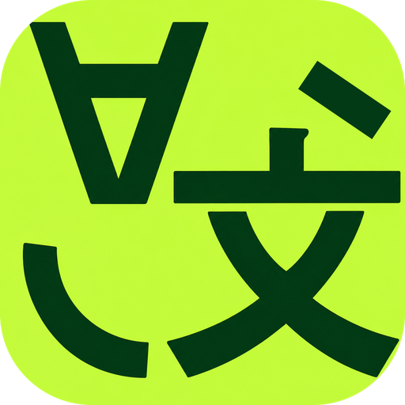
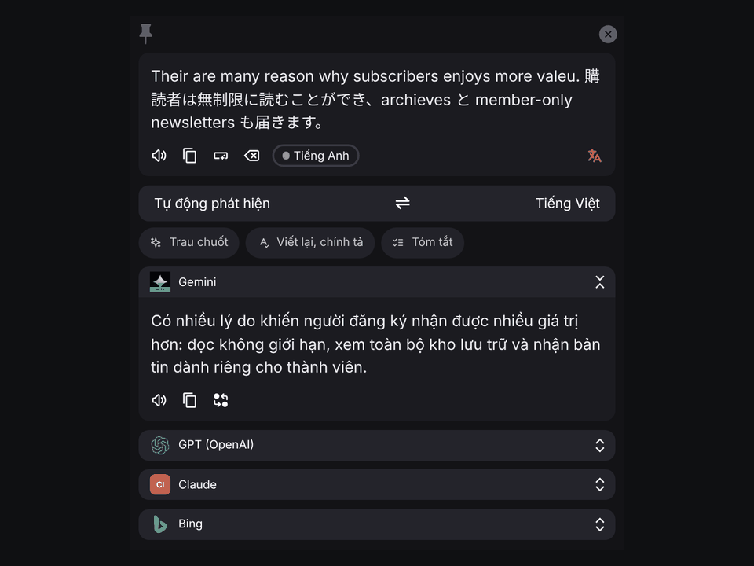
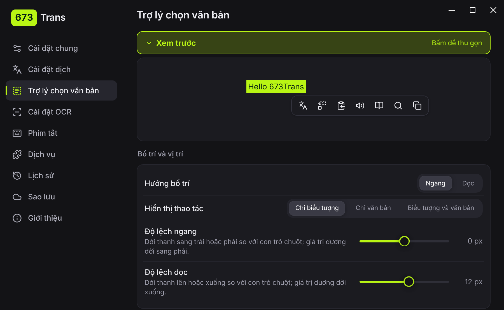
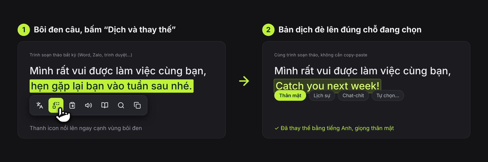
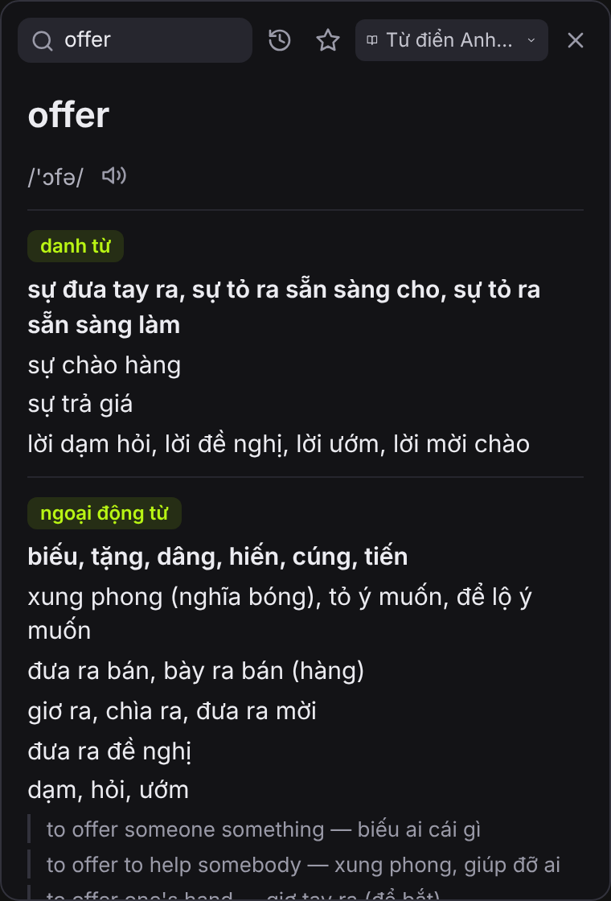
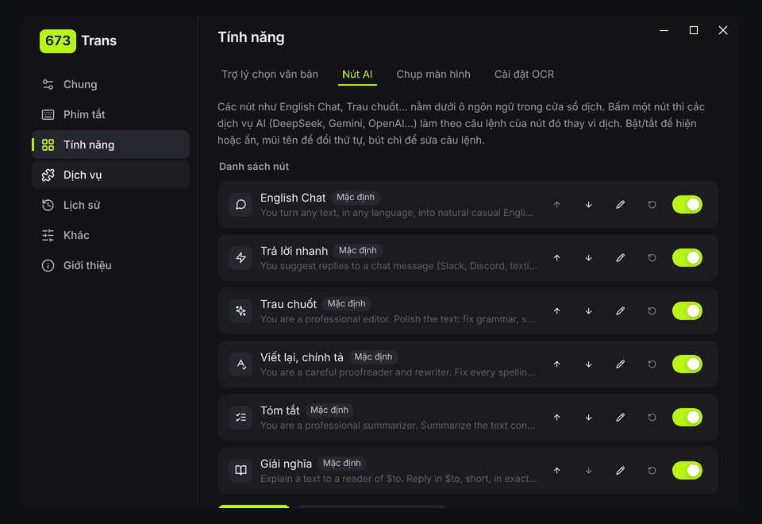

# 673Trans

> Bôi đen chữ ở bất kỳ app nào để dịch, viết lại, tra từ hay nghe đọc. Dùng được Google, Bing và các AI (DeepSeek, Claude, GPT, Gemini…), kèm từ điển Anh–Việt offline, OCR và chụp màn hình có công cụ vẽ.


<br/>

<p align="center">
  <a href="https://github.com/nguyenguyen673/673Trans/releases/latest"></a>
</p>
<p align="center">
  <a href="https://github.com/nguyenguyen673/673Trans/releases/download/v3.27.9/673Trans-3.27.9-windows.exe">Windows 10/11 (.exe)</a> &middot;
  <a href="https://github.com/nguyenguyen673/673Trans/releases/download/v3.27.9/673Trans-3.27.9-mac-aarch64.dmg">macOS Apple Silicon</a> &middot;
  <a href="https://github.com/nguyenguyen673/673Trans/releases/download/v3.27.9/673Trans-3.27.9-mac-x64.dmg">macOS Intel</a> &middot;
  <a href="https://github.com/nguyenguyen673/673Trans/releases">Các bản khác</a>
</p>
<p align="center">Bản 3.27.9 &middot; Windows chỉ cần 1 file, không cần cài &middot; app tự báo khi có bản mới</p>

<hr/>

## 673Trans là gì?

673Trans là app dịch chạy nền, nằm dưới khay hệ thống. Bạn không cần copy rồi dán sang trang dịch: bôi đen chữ ở bất kỳ đâu (trình duyệt, Word, Slack, game, PDF…) là có ngay bản dịch, bản viết lại hoặc nghĩa của từ, ngay cạnh con trỏ.

**Cách dùng:**

1. **Bôi đen chữ**: một thanh icon nhỏ hiện cạnh con trỏ.
2. **Chọn việc cần làm**: dịch, dịch và dán đè, tra từ, đọc to, hoặc một nút AI như English Chat hay Trau chuốt. Mỗi việc cũng gán được phím tắt riêng.
3. **Xem kết quả**: bản dịch hiện trong cửa sổ nhỏ, so sánh được nhiều dịch vụ cùng lúc. Với chữ trong ảnh hay video, bấm phím chụp màn hình rồi khoanh vùng để OCR và dịch.

Mặc định dùng Google miễn phí. Muốn dịch hay hơn, tự nhiên hơn thì gắn khoá API của các AI (DeepSeek, Claude, GPT, Gemini…). Giao diện có tiếng Việt và tiếng Anh.

## Điểm nổi bật

- **Nút AI**: English Chat, Trả lời nhanh, Trau chuốt, Viết lại, Tóm tắt, Giải nghĩa, hoặc tự tạo nút của riêng bạn.
- **Dịch và thay thế**: bản dịch dán đè đúng chỗ đang chọn; với chữ chỉ đọc (web, PDF) thì hiện đè lên ngay tại chỗ.
- **Từ điển Anh–Việt offline** có phiên âm và giọng đọc UK/US.
- **OCR và chụp màn hình** có công cụ vẽ, dịch luôn chữ trong ảnh.
- **Giọng đọc AI** và giọng Edge neural có sẵn.
- **Tự cập nhật**, sao lưu lên WebDAV hoặc Google Drive.

<p align="center"></p>

## Tính năng

<details>
<summary><b>Nút AI</b></summary>

Các nút nằm ngay dưới thanh ngôn ngữ của cửa sổ dịch; bấm một nút để AI xử lý đoạn đang chọn, bấm lại để quay về dịch thường. Chỉ chạy với dịch vụ AI.

| Nút | Làm gì |
|---|---|
| English Chat | Chuyển mọi ngôn ngữ sang tiếng Anh giọng chat tự nhiên |
| Trả lời nhanh | Gợi ý 3 câu trả lời cho một tin nhắn, bấm câu nào là chép câu đó |
| Trau chuốt | Viết lại mượt, chuyên nghiệp, giữ nguyên ý |
| Viết lại | Sửa chính tả, ngữ pháp, ít can thiệp |
| Tóm tắt | Rút gọn thành vài ý chính |
| Giải nghĩa | Nghĩa tổng quát, dịch sát nghĩa và giải thích từ khó |

Trong **Cài đặt → Tính năng → Nút AI** (hoặc nút **+** cạnh hàng nút) bạn ẩn/hiện, sắp xếp, sửa câu lệnh, đổi biểu tượng hoặc thêm nút mới. Mỗi nút gán được phím tắt riêng (dán đè kết quả hoặc mở cửa sổ dịch) và có thể hiện trên thanh icon nổi.

</details>

<details>
<summary><b>Thanh icon nổi khi chọn chữ</b></summary>



- Hiện cạnh con trỏ khi bôi đen chữ, nhấp đúp một từ hoặc Ctrl+A, ở bất kỳ app nào.
- Các nút: Dịch, Dịch và thay thế, Dịch và sao chép, Đọc to, Tra từ điển, Gõ từ, Sao chép, cùng các nút AI bạn chọn.
- Kéo thả đổi thứ tự, ngang/dọc, chỉ icon hoặc có chữ, lọc theo ứng dụng, có ô xem trước trong cài đặt.

<br clear="right"/>

**Dịch và thay thế**: bản dịch được dán đè đúng chỗ đang chọn. Nếu chữ không sửa được (trang web, PDF), bản dịch hiện đè lên ngay vị trí đó, cuộn trang hoặc bấm Esc là tắt.

<p align="center"></p>

</details>

<details>
<summary><b>Từ điển</b></summary>



- Tô một từ rồi bấm icon quyển sách hoặc phím tắt; popup kiểu Cambridge có IPA và giọng UK/US.
- 3 nguồn: **Anh–Việt offline** (103k từ, nhúng sẵn, tra ngược Việt → Anh), **Wiktionary** (giọng ghi âm thật, câu ví dụ), **Từ điển AI**. Thêm nguồn khác bằng plugin.
- Lưu từ vào sổ từ vựng (có thể đẩy sang Anki, Eudic), lịch sử tra, giải thích bằng AI.

<br clear="right"/>

</details>

<details>
<summary><b>Dịch vụ, OCR và giọng đọc</b></summary>

- **Dịch**: Google (mặc định), Bing (cần khoá Azure miễn phí), DeepSeek, Claude, GPT, Gemini và mọi dịch vụ tương thích OpenAI (OpenRouter, Qwen, Kimi, LM Studio…). Dịch vụ AI có mục Nâng cao: temperature, độ dài tối đa, chế độ suy nghĩ, kiểm tra kết nối.
- **OCR**: Windows OCR và Tesseract offline (Anh, Việt, Trung) có sẵn; thêm OCR bằng AI.
- **Giọng đọc**: giọng Edge neural có sẵn, ElevenLabs, OpenAI TTS, Gemini TTS.
- Bật/tắt và kéo thả sắp xếp từng dịch vụ mà không cần xoá.

</details>

<details>
<summary><b>Chụp màn hình</b></summary>

Màn hình tối đi để bạn khoanh vùng; chọn xong có thanh công cụ vẽ (bút, dạ quang, mũi tên, khung, elip, chữ, làm mờ) và thanh thao tác (sao chép, lưu, OCR, dịch ảnh). Enter xong, Esc huỷ, Ctrl+Z/Y, Ctrl+C, Ctrl+S. Tuỳ chỉnh được kính lúp, phát hiện cửa sổ, màu nét mặc định, định dạng và nơi lưu ảnh.

</details>

<details>
<summary><b>Tuỳ chỉnh</b></summary>

<p align="center"></p>

- **Phím tắt** cho gần như mọi thao tác: dịch vùng chọn, dịch và thay thế, chụp màn hình (cả Print Screen), OCR, tra từ, đọc to, từng nút AI.
- **Cài đặt dịch**: ngôn ngữ nguồn/đích và đích dự phòng, tự sao chép, dịch khi đang gõ, có ô xem trước.
- **Giao diện**: tiếng Việt/Anh, sáng/tối, màu chủ đạo, cỡ chữ, vị trí cửa sổ, ghim, thu gọn ô nguồn.
- **Khác**: proxy HTTP/SOCKS5, lịch sử dịch, sao lưu ra tệp, WebDAV hoặc Google Drive.

</details>

## Cho người dùng nâng cao

<details>
<summary><b>Gọi 673Trans từ app khác (localhost)</b></summary>

App mở sẵn một máy chủ nội bộ tại `http://127.0.0.1:60828` (chỉ máy bạn truy cập được; đổi cổng ở Cài đặt chung). Script, AutoHotkey, Stream Deck hay bất kỳ app nào gửi được yêu cầu HTTP đều điều khiển được app:

| Địa chỉ | Việc làm |
|---|---|
| `POST /translate` (nội dung gửi = văn bản) | Mở cửa sổ dịch với đoạn văn bản đó |
| `/selection_translate` | Dịch vùng đang chọn ở app đang dùng |
| `/input_translate` | Mở cửa sổ dịch để gõ |
| `/ocr_recognize` | Chụp màn hình và nhận dạng chữ |
| `/ocr_translate` | Chụp màn hình, nhận dạng và dịch |
| `/config` | Mở cửa sổ cài đặt |

Thêm `?screenshot=false` vào hai địa chỉ OCR để dùng lại ảnh chụp trước thay vì chụp mới.

```powershell
# PowerShell: dịch một đoạn văn bản
Invoke-RestMethod -Method Post -Uri http://127.0.0.1:60828/translate -Body "Hello world"

# dịch vùng đang chọn (gắn vào phím tắt của AutoHotkey, Stream Deck...)
Invoke-RestMethod http://127.0.0.1:60828/selection_translate
```

</details>

<details>
<summary><b>Tự tạo plugin cho bản thân</b></summary>

Plugin mở rộng được 4 loại dịch vụ: **dịch**, **OCR**, **giọng đọc** và **sổ từ vựng**. Cài bằng nút **Thêm plugin** trong Cài đặt → Dịch vụ (chọn file `.potext`).

Một plugin là một thư mục (nén thành `.potext`) gồm:

- `info.json`: `id` (bắt đầu bằng `plugin`), `display` (tên hiện ra), `icon`, `language` (đổi mã ngôn ngữ của app sang mã mà dịch vụ của bạn dùng), `needs` (các ô cấu hình như khoá API, kiểu `input` hoặc `select`).
- `main.js`: hàm chính theo loại plugin, ví dụ plugin dịch:

```js
async function translate(text, from, to, options) {
    const { config, detect, setResult, utils } = options;
    const { tauriFetch: fetch } = utils;   // gọi HTTP, không bị chặn CORS
    const res = await fetch('https://api.example.com/translate', {
        method: 'POST',
        body: { type: 'Json', payload: { text, from, to, key: config.apiKey } },
    });
    return res.data.result;                // trả về chuỗi; dịch theo luồng thì gọi setResult(...)
}
```

`utils` còn có `run` để chạy một chương trình có sẵn trên máy (ví dụ mô hình dịch chạy cục bộ), `CryptoJS`, `Database` và đường dẫn thư mục plugin. Plugin nằm ở `%APPDATA%\com.pot-app.desktop\plugins\<loại>\<tên>`, sửa `main.js` rồi mở lại cửa sổ là thấy kết quả.

</details>

<details>
<summary><b>Sao lưu lên Google Drive của bạn</b></summary>

Vào **Sao lưu**, thẻ **Google Drive**, bấm **Cấu hình**. App không có khóa dùng chung, bạn tạo khóa của riêng mình (làm một lần, miễn phí):

1. Vào [Google Cloud Console](https://console.cloud.google.com/), tạo project, bật **Google Drive API**.
2. **APIs & Services → Credentials → Create credentials → OAuth client ID**, loại **Desktop app**. Nếu được hỏi, cấu hình màn hình đồng ý (OAuth consent screen) ở chế độ Testing và thêm email của bạn vào **Test users**.
3. Dán **Client ID** và **Client Secret** vào app, bấm **Đăng nhập Google**, đồng ý trên trình duyệt.
4. Bấm **Xuất ngay** để sao lưu, **Duyệt bản sao lưu** để khôi phục.

Bản sao lưu (cài đặt, lịch sử, plugin) nằm trong thư mục ẩn của app trên Drive. App chỉ có quyền `drive.appdata`, không thấy file khác của bạn. Khóa đăng nhập lưu trong `config.json` trên máy bạn.

</details>

<details>
<summary><b>Bản macOS (thử nghiệm)</b></summary>

Bản macOS chưa được thử trên máy Mac thật. File `.dmg` được build trên GitHub (tab **Actions → Build macOS → Run workflow**, điền tag release để tự đính vào Release). Có hai bản: `aarch64` (Apple Silicon M1/M2/M3…) và `x64` (Intel).

App chưa ký số của Apple, nên lần đầu mở:
1. Kéo 673Trans vào Applications.
2. Chuột phải vào app, chọn **Open**, hoặc chạy `xattr -cr /Applications/673Trans.app` trong Terminal.
3. Cấp quyền **Accessibility** và **Screen Recording** trong System Settings → Privacy & Security để dùng thanh icon nổi, thay thế văn bản và OCR chụp màn hình.

Trên macOS, tự cập nhật chỉ mở trang tải về trong trình duyệt, không tự thay file như Windows.

</details>

<details>
<summary><b>Bảo mật</b></summary>

- Khi bật **Tự cập nhật**, app chỉ tải từ release của repo này, tải đúng file của bản mới nhất và kiểm tra mã SHA-256 do GitHub công bố trước khi thay file.
- API localhost chỉ nhận lệnh từ chương trình chạy trên máy bạn (trang web trong trình duyệt bị chặn). Muốn chặt hơn, thêm `"server_token": "mật-khẩu-của-bạn"` vào `config.json` rồi gửi kèm header `X-Token`.
- Plugin muốn chạy chương trình ngoài (ví dụ Python) sẽ hiện hộp thoại hỏi bạn một lần cho mỗi plugin. Chỉ cài plugin bạn tin tưởng.
- Chế độ **theo dõi clipboard** (tắt mặc định) chỉ dịch nội dung mới sao chép sau khi bật, bỏ qua nội dung rỗng hoặc quá dài.
- Nội dung bạn dịch sẽ được gửi tới dịch vụ bạn chọn (Google, Bing, DeepSeek...). Với nội dung nhạy cảm, dùng các chức năng offline (từ điển Anh–Việt offline, OCR Tesseract).

</details>

<details>
<summary><b>Build từ mã nguồn</b></summary>

Cần Node.js 18+, pnpm, Rust và Visual Studio Build Tools (Desktop development with C++).

```
pnpm install
pnpm tauri dev      # chạy thử
pnpm tauri build    # ra bản cài đặt
```

Hướng dẫn chi tiết và cách tự thêm hãng AI: xem [HUONG-DAN.md](HUONG-DAN.md).

</details>

<details>
<summary><b>Ghi công và giấy phép</b></summary>

673Trans phát hành theo giấy phép [GPL-3.0](LICENSE), dựa trên [Pot](https://github.com/pot-app/pot-desktop).

Dữ liệu từ điển Anh–Việt offline là của [Dự án Từ điển tiếng Việt miễn phí](https://www.informatik.uni-leipzig.de/~duc/Dict/) (Hồ Ngọc Đức); Wiktionary thuộc Wikimedia Foundation, nội dung theo CC BY-SA, dữ liệu trích qua [kaikki.org](https://kaikki.org).

</details>
